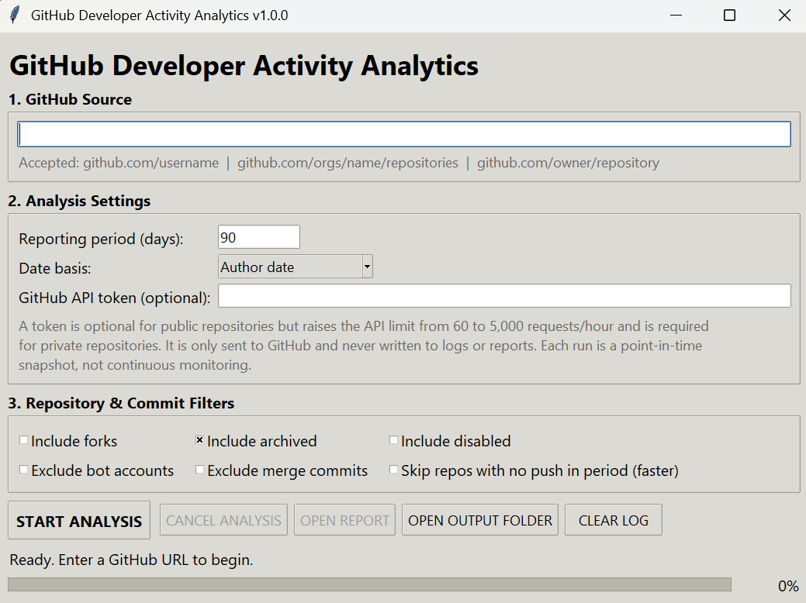
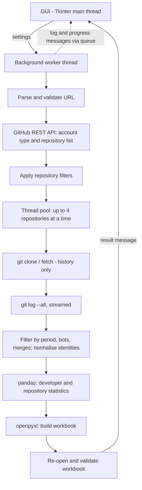

<div align="center">

# GitHub Developer Activity Analytics

**A Windows-oriented Python desktop application that reports who committed what, where and when across a GitHub user, organisation or repository — and exports the result as a reconciled Excel workbook.**


[](LICENSE)


</div>

---

## Table of contents

1. [Overview](#overview)
2. [Problem statement and purpose](#problem-statement-and-purpose)
3. [Feature highlights](#feature-highlights)
4. [Screenshot](#screenshot)
5. [Technology stack](#technology-stack)
6. [Architecture and workflow](#architecture-and-workflow)
7. [Prerequisites](#prerequisites)
8. [Installation and running from source](#installation-and-running-from-source)
9. [Step-by-step user guide](#step-by-step-user-guide)
10. [GUI reference](#gui-reference)
11. [Supported GitHub URL formats](#supported-github-url-formats)
12. [GitHub token setup](#github-token-setup)
13. [The Excel report](#the-excel-report)
14. [Output folders and generated files](#output-folders-and-generated-files)
15. [Identity normalisation and aliases](#identity-normalisation-and-aliases)
16. [Command-line options](#command-line-options)
17. [Troubleshooting](#troubleshooting)
18. [Limitations and important considerations](#limitations-and-important-considerations)
19. [Security and privacy](#security-and-privacy)
20. [Documentation](#documentation)
21. [Contributing and support](#contributing-and-support)
22. [Author](#author)
23. [Licence](#licence)
24. [Citation](#citation)

---

## Overview

GitHub Developer Activity Analytics answers questions such as *"How many developers committed to
this organisation in the last 90 days, how many commits did they make, and over what period?"*

You give it a GitHub URL (a user, an organisation or a single repository), a reporting period in
days and, optionally, a personal access token. The application

1. asks the **GitHub REST API** which repositories exist (discovery and metadata only),
2. uses the **Git command line** to clone each repository's *history* (no working files are
   checked out) and read its commits, and
3. writes an **Excel workbook** that counts active developers and commits, measures how long and
   on how many days they were active, and documents exactly which repositories were included,
   excluded, skipped or failed, with built-in consistency checks.

It reads **commit metadata** (author, committer, dates, parent count, first line of the message).
It does not read file contents or diffs.

> Each run is a **point-in-time snapshot** of the Git history that was reachable when the run
> happened. It is not a continuous monitoring tool.

## Problem statement and purpose

Counting "active developers" is surprisingly hard to do reliably by hand. The GitHub web
interface shows contributors per repository, but not a consolidated, auditable view across every
repository of an organisation for a chosen period, and the same person often commits under
several names or e-mail addresses. This application automates that work: it discovers the
repositories, reads the real commit history with Git, normalises developer identities
transparently, and produces a workbook in which every number can be traced back and reconciled
(commits read = commits kept + commits excluded, repositories discovered = analysed + excluded +
skipped + failed + not processed).

## Feature highlights

| Area | What the application does |
| --- | --- |
| **Inputs** | GitHub user, organisation or single-repository URL (several URL spellings are accepted, see [below](#supported-github-url-formats)). |
| **Period** | Last *N* days, 1–3650 (default 90). The window is computed in UTC. |
| **Date basis** | Filter and report on either the **author date** (default) or the **committer date**. Both are stored for every commit. |
| **Discovery** | GitHub REST API with pagination, retries with exponential back-off, and primary/secondary rate-limit handling. |
| **History extraction** | History-only clone (`--no-checkout`, partial-clone filter with fallback), `git fetch --all --prune` for existing copies, `git log --all` streamed with bounded memory. |
| **Parallelism** | Up to 4 repositories are processed concurrently (fixed in the source, not a GUI option). |
| **Filters** | Forks, archived and disabled repositories, bot accounts, merge commits, repositories with no push in the period. |
| **Identity handling** | GitHub noreply login → e-mail address → display name, plus optional explicit merging via `identity_aliases.json`. |
| **Authentication** | Optional personal access token for API and Git; redacted from logs, errors and reports. |
| **Control** | Progress bar, execution log, cancellation that stops running Git processes and still writes a partial report. |
| **Report** | Eight-worksheet Excel workbook with totals, reconciliation, error list and integrity checks; the saved file is re-opened and cross-validated. |
| **Runtime checks** | Git is taken from a PortableGit folder beside the script when one is present (Windows), otherwise from `PATH`; `--self-test` verifies the environment. |

## Screenshot

Main window on Windows (Tkinter), at start-up with default settings:



## Technology stack

| Component | Used for |
| --- | --- |
| Python 3.9+ (as stated in the source; see [Prerequisites](#prerequisites)) | Application language |
| `tkinter` / `ttk` (standard library) | GUI |
| [`requests`](https://requests.readthedocs.io/) | GitHub REST API calls |
| [`pandas`](https://pandas.pydata.org/) | Normalising and aggregating commit records |
| [`openpyxl`](https://openpyxl.readthedocs.io/) | Writing and re-validating the Excel workbook |
| Git command line (2.31+ when a token is used) | Cloning, fetching and reading history |
| `threading`, `queue`, `concurrent.futures` (standard library) | Background worker, parallel repositories, GUI messaging |

## Architecture and workflow



A more detailed description is in [docs/ARCHITECTURE.md](docs/ARCHITECTURE.md).

## Prerequisites

**To run from source**

* **Python 3.9 or newer.** The source file states 3.9+. The analysis and report pipeline was
  exercised only on Python 3.12 while preparing this repository; other versions are untested.
* **Tkinter.** Included with the python.org installers for Windows (keep *tcl/tk and IDLE*
  ticked). Some Linux distributions package it separately (for example `python3-tk` on
  Debian/Ubuntu). Tkinter is not installed with pip.
* **Git 2.31 or newer** on your `PATH` (Git for Windows from <https://git-scm.com/downloads>).
  A token requires Git 2.31+; without a token the application does not enforce a minimum version.
* Python packages from [`requirements.txt`](requirements.txt): `pandas`, `requests`, `openpyxl`.
* Internet access to `api.github.com` and `github.com`.
* Free disk space for the local clones (the application refuses to clone when less than 300 MB
  is free on the cache drive).

## Installation and running from source

```powershell
# 1. Get the code
git clone https://github.com/<your-account>/GitHub-Developer-Activity-Analytics.git
cd GitHub-Developer-Activity-Analytics

# 2. Create and activate a virtual environment
python -m venv .venv
.\.venv\Scripts\Activate.ps1

# 3. Install the runtime dependencies
python -m pip install -r requirements.txt

# 4. Start the application
python GitHub_Developer_Analytics.py
```

> Replace `<your-account>` with the account that hosts your copy of the repository. On macOS or
> Linux use `source .venv/bin/activate`. The code contains non-Windows branches, but Windows is
> the primary platform. The analysis pipeline was run headlessly on Linux while preparing this
> repository; the GUI was not run on macOS or Linux. See
> [docs/INSTALLATION.md](docs/INSTALLATION.md) for details.

Check the environment without starting the GUI:

```powershell
python GitHub_Developer_Analytics.py --self-test
```

## Step-by-step user guide

1. **Start** the application.
2. **Enter a GitHub URL** in section *1. GitHub Source*, for example
   `https://github.com/example-organization` or
   `https://github.com/example-organization/sample-repository`.
3. **Choose the period** (days) and the **date basis** in *2. Analysis Settings*.
4. **Optionally paste a GitHub token** — needed for private repositories, and recommended for
   large organisations because it raises the API rate limit from 60 to 5,000 requests per hour.
5. **Set the filters** in *3. Repository & Commit Filters*.
6. Click **START ANALYSIS** (or press **Enter** in the URL field). The progress bar and log show
   what is happening. You can click **CANCEL ANALYSIS** at any time.
7. When the run ends, a dialog summarises the outcome and the report path. Click **OPEN REPORT**
   or **OPEN OUTPUT FOLDER**.
8. Start with the **Summary** worksheet: check the *run outcome*, the *repository reconciliation*
   and the *integrity checks* before reading the numbers.

A fuller walkthrough, including how to interpret the results, is in
[docs/USER_GUIDE.md](docs/USER_GUIDE.md).

## GUI reference

| Control | Default | Description |
| --- | --- | --- |
| **GitHub URL** entry | empty | The user, organisation or repository to analyse. Validated before the run starts. Pressing Enter starts the analysis. |
| **Reporting period (days)** | `90` | Whole number from 1 to 3650. The window runs from *now − N days* to the moment the run started (both inclusive, UTC). |
| **Date basis** | Author date | *Author date*: when the developer wrote the commit. *Committer date*: when the commit was applied, merged or rebased. Used for the period filter and every statistic. |
| **GitHub API token (optional)** | empty | Masked field. Used for API calls and Git operations against `github.com`. Never written to logs or reports. |
| **Include forks** | off | Include repositories that are forks. Off: forks are listed as *Excluded*. |
| **Include archived** | **on** | Include archived (read-only) repositories. |
| **Include disabled** | off | Include repositories disabled on GitHub. A disabled repository that is included normally fails to clone and is reported as *Failed*. |
| **Exclude bot accounts** | off | Drop commits whose author name or e-mail user part looks like a bot (see [Limitations](#limitations-and-important-considerations)). |
| **Exclude merge commits** | off | Drop commits that have more than one parent. |
| **Skip repos with no push in period (faster)** | off | Skip repositories whose last push on GitHub is more than 2 days older than the start of the period. |
| **START ANALYSIS** | enabled | Validates the inputs and starts the background run. |
| **CANCEL ANALYSIS** | disabled until a run starts | Requests cancellation. Running Git processes are stopped; a partial report is written. |
| **OPEN REPORT** | disabled until a report exists | Opens the last generated workbook. |
| **OPEN OUTPUT FOLDER** | enabled | Opens the folder that contains the reports. |
| **CLEAR LOG** | enabled | Clears the on-screen log (the session log file is not affected). |
| Status line / progress bar | — | Shows the current stage and "Processed *x* of *y* selected repositories". |
| **Execution Log** | — | Live log. Limited to the most recent 5,000 lines on screen. |

When a single repository URL is entered, the fork / archived / disabled filters are **not**
applied — an explicitly named repository is always analysed.

## Supported GitHub URL formats

| Form | Interpreted as |
| --- | --- |
| `github.com/example-organization` · `https://github.com/example-organization` | Account (user or organisation, detected through the API) |
| `https://github.com/orgs/example-organization` · `…/orgs/example-organization/repositories` | Account |
| `https://github.com/users/developer_alpha` | Account |
| `https://github.com/example-organization/sample-repository` | Single repository |
| `https://github.com/example-organization/sample-repository/tree/main` | Single repository (extra path ignored) |
| `https://github.com/example-organization/sample-repository.git` | Single repository |
| `git@github.com:example-organization/sample-repository.git` | Single repository |

Only `github.com` and `www.github.com` are accepted. URLs containing credentials are rejected
(use the token field). Other hosts, including GitHub Enterprise Server, are rejected by the URL
check.

## GitHub token setup

A token is **optional** for public repositories and **required** for private ones.

1. On GitHub open **Settings → Developer settings → Personal access tokens**.
2. Prefer a **fine-grained token**: set the *resource owner* (your account or the organisation),
   choose the repositories it may read, and grant **read-only** access to *Metadata* and
   *Contents*. A **classic token** with the `repo` scope also works for private repositories but is
   broader than necessary.
3. Set an expiry date.
4. If the organisation enforces **SAML single sign-on**, authorise the token for that
   organisation, otherwise GitHub returns a 403 and the application reports
   *"Organization requires SAML SSO authorisation"*.
5. Paste the token into the **GitHub API token** field.

> The permission names above follow GitHub's own documentation for listing and cloning
> repositories. The application itself does not inspect token scopes, and this README's scope
> guidance was **not verified against a live private repository**. If a private repository
> cannot be read, adjust the token permissions in GitHub.

How the token is used: it is sent as a `Bearer` header to `api.github.com`, and to Git as an
HTTP header for `https://github.com/` only (through environment variables, not the command line).
When your own username is analysed with your own token, your private repositories are included
(the API call that lists repositories you own is used). Details:
[docs/SECURITY_AND_PRIVACY.md](docs/SECURITY_AND_PRIVACY.md).

## The Excel report

The report is saved as `.xlsx`. It contains **eight worksheets** in this order. All values are
static (the workbook contains **no formulas**); every data sheet has a frozen header row,
filters, banded rows and a landscape print layout, and all timestamps are **UTC**.

| # | Worksheet | Purpose |
| --- | --- | --- |
| 1 | **Summary** | Run outcome, headline KPIs, report details, reporting period, repository reconciliation, commit and developer results, filters applied, run notes, and the complete developer list. Start here. |
| 2 | **Active Developers** | One row per unique developer identity with commits in the period; compact view. |
| 3 | **Developer Summary** | Same developers with rank, identity information, averages and name/e-mail variants. |
| 4 | **Repository Summary** | One row per *analysed* repository: commits, developers and activity span. |
| 5 | **Commit Details** | One row per qualifying commit (the raw data behind every other sheet). |
| 6 | **Repository Status** | One row per *discovered* repository: filters, status, reason and a ledger of commits read versus kept. |
| 7 | **Processing Errors** | Every failure and non-fatal data note, with category, retry count and a suggested action. |
| 8 | **Integrity Checks** | Cross-checks that totals agree across sheets (PASS / WARN / FAIL). |

If a run produces more than 1,000,000 commit rows, *Commit Details* continues on
*Commit Details (2)*, *(3)* and so on (Excel allows about 1.05 million rows per sheet).

### Key columns and metrics

| Name | Meaning |
| --- | --- |
| **Date Used (UTC)** | The commit date the report is based on: the author date or the committer date, according to the *Date basis* setting. |
| **Total Commits** | Qualifying commits (inside the period, after the bot/merge filters). A commit that exists in two repositories (for example a fork) counts once in each. |
| **Share of Total Commits (%)** | The developer's (or repository's) commits divided by all qualifying commits, two decimals. |
| **Repository Count** | Number of repositories in which the developer has qualifying commits. |
| **First / Latest Commit Date (UTC)** | Earliest and latest `Date Used (UTC)` of the row's qualifying commits. |
| **Commit Activity Duration (Days)** | Inclusive number of calendar days from the first to the latest commit date. It describes the *length of the period*, not days worked. |
| **Active Days** | Number of distinct UTC calendar dates with at least one commit. |
| **Avg Commits per Active Day** | Total commits ÷ active days (Developer Summary). |
| **Normalised Developer Identity** | The key used to decide that two commits belong to the same developer, for example `github:developer_alpha` or `email:developer@example.invalid`. |
| **Identity Method** | How that key was derived: *GitHub noreply (login)*, *E-mail address*, *Display name only (no valid e-mail)*, *Unknown (no author metadata)* or *Alias mapping*. |
| **Commits Read (all history)** | Commit records returned by `git log --all` for the repository, before any filtering. |
| **Commits Found** | Qualifying commits kept. |
| **Excluded: …** | Commits dropped, by reason: *Bots*, *Merges*, *Outside Period*, *Invalid/Duplicate Records*. |
| **Processing Status** | *Analysed*, *Excluded*, *Skipped*, *Failed* or *Cancelled / Not Processed* (colour-coded). |

The ledger always balances: **Commits Read = Commits Found + all "Excluded:" columns**, and
**repositories discovered = analysed + excluded + skipped + failed + cancelled / not processed**.

The TOTAL rows under *Active Developers*, *Developer Summary*, *Repository Summary* and
*Repository Status* sit below the filtered range. Note that *Repository Count* (Active
Developers / Developer Summary) and *Unique Developers* (Repository Summary) add up
**developer–repository pairs**, not distinct people, and that the overall span and active-day
figures are calculated across all rows and are **not** the sum of the rows above.

Illustrative *Active Developers* rows (fictional data):

| Developer Name | Developer Email | Total Commits | Repository Count | First Commit Date (UTC) | Latest Commit Date (UTC) | Commit Activity Duration (Days) | Active Days | Share of Total Commits (%) |
| --- | --- | --- | --- | --- | --- | --- | --- | --- |
| developer_alpha | developer.alpha@example.invalid | 42 | 3 | 2026-01-05 09:12:44 | 2026-03-28 16:03:10 | 83 | 17 | 61.76 |
| developer_beta | developer.beta@example.invalid | 26 | 1 | 2026-02-11 13:40:02 | 2026-03-20 08:55:31 | 38 | 11 | 38.24 |

The column-by-column reference for every worksheet is in
[docs/USER_GUIDE.md](docs/USER_GUIDE.md#excel-report-reference).

## Output folders and generated files

| Item | Location when run from source |
| --- | --- |
| Reports | `output/` next to the script |
| Logs | `logs/` next to the script |
| Repository cache | `repositories/` next to the script |
| Alias file | `identity_aliases.json` next to the script (or in the data folder below) |

If the folder next to the script is not writable, the application falls back to
`%LOCALAPPDATA%\GitHub_Developer_Activity_Analytics` (on non-Windows systems
`~/.local/share/GitHub_Developer_Activity_Analytics`), or the system temp folder as a last resort.
These folders are listed in `.gitignore` so that reports and clones are never committed by accident.

| File | Description |
| --- | --- |
| `Git_Developer_Activity_<owner>_<days>d_<author\|committer>_<yyyymmdd_hhmmss>.xlsx` | The report. Never overwrites an existing file (`_2`, `_3`, … are appended). |
| `…_PARTIAL.xlsx` | Run finished with failures, skipped repositories, incomplete discovery or integrity failures. |
| `…_CANCELLED.xlsx` | Run was cancelled; contains what was processed. |
| `commit_details_fallback_<yyyymmdd_hhmmss>.csv` | Written only if the workbook itself cannot be saved. |
| `session_<yyyymmdd_hhmmss>.log` | Session log. |
| `selftest_<yyyymmdd_hhmmss>.txt` | Result of `--self-test`. |

The repository cache is **not deleted automatically**; later runs reuse and update it. It can be
large — delete the `repositories` folder when you want the space back.

## Identity normalisation and aliases

Every commit author is reduced to an **identity key**. Developers are counted by key, not by
person. The order of trust is:

1. `…@users.noreply.github.com` address → `github:<login>` (a leading numeric id is ignored)
2. any other syntactically valid e-mail → `email:<address in lower case>`
3. no valid e-mail but a name → `name:<display name in lower case>`
4. nothing → `unknown:(no author metadata)`

Different e-mail addresses are **never merged automatically**, and display names are not used
when an e-mail exists. One person who commits with two e-mail addresses therefore appears
twice, unless you merge them with an alias file.

To merge identities, create `identity_aliases.json` next to the script — start from
[`examples/identity_aliases.example.json`](examples/identity_aliases.example.json):

```json
{
  "email:developer.old@example.invalid": "github:developer_alpha",
  "email:developer.alpha@example.invalid": "github:developer_alpha",
  "name:developer beta": "github:developer_beta"
}
```

* The **key** is an identity key as shown in the *Normalised Developer Identity* column
  (copy it from a previous report). The **value** is the identity it should become.
* Keys and values are compared in lower case.
* Merged rows get the identity method *Alias mapping*. The displayed name and e-mail are the
  most frequent ones among the merged commits; the others are listed under *Name Variants* and
  *Email Variants* in *Developer Summary*.
* The file is read when a run starts. If it cannot be read or parsed as JSON, the run continues
  without aliases and the problem is shown as a warning. A file whose top level is not a JSON
  object is ignored.

Your real `identity_aliases.json` is listed in `.gitignore` so that it is not committed by accident.

## Command-line options

| Command | Effect |
| --- | --- |
| `python GitHub_Developer_Analytics.py` | Start the GUI. |
| `python GitHub_Developer_Analytics.py --version` | Show the application name and version. |
| `python GitHub_Developer_Analytics.py --self-test [--online]` | Check the runtime (imports, writable folders, certificates, Tk, Excel writing, Git) and save the result to `logs`. `--online` adds an HTTPS test against `api.github.com` and a `git ls-remote` against `github.com`. Exit code 0 when all checks pass, 1 otherwise. |
| `python GitHub_Developer_Analytics.py --emit-build-files [folder]` | Optional developer helper that writes a PyInstaller `.spec` file and a Windows version resource. Not needed to run the application; this repository contains no build instructions and distributes no executable. |

## Troubleshooting

| Message / symptom | Likely cause and action |
| --- | --- |
| *Git Not Found* | Git is not installed or not on `PATH`, or a PortableGit folder beside the script is incomplete. Install Git (see [docs/INSTALLATION.md](docs/INSTALLATION.md)). |
| *Git … is too old for secure token authentication* | A token was entered and Git is older than 2.31. Update Git. |
| *Authentication: GitHub rejected the credentials* | Token invalid or expired. Create a new one, or clear the field for public data. |
| *Rate limit (primary / secondary)* | API quota used up. The application waits up to 120 s automatically; for longer waits it stops. Use a token (5,000 requests/hour) or retry after the reset time shown. |
| *Not found / no access* | Wrong URL, or the account/repository is private and the token cannot read it. |
| *Permission* (HTTP 403) | The token lacks the needed permission. |
| *Organization requires SAML SSO authorisation* | Authorise the token for the organisation in GitHub's token settings. |
| *SSL certificate* | A proxy or antivirus is inspecting HTTPS. Install the corporate root certificate for Git/Windows, or exclude `api.github.com` / `github.com`. For the Python (API) side you can point `REQUESTS_CA_BUNDLE` at a trusted PEM CA bundle. Certificate verification is never disabled by the application. |
| *Network* / *Timeout* | Check connection, DNS, proxy and firewall. Transient failures are retried automatically (API: 4 times, Git: 2 times). |
| *Disk space* | Less than 300 MB free on the cache drive. Free space or delete the `repositories` folder. |
| *Antivirus / file lock* | Another program holds the freshly written clone. Exclude the repository cache folder from antivirus and indexing, then run again; finished clones are reused. |
| *Corrupted local repository* | The application re-clones the repository automatically and restores the old copy if that fails. |
| *Disabled repository* | The repository is disabled on GitHub. Leave **Include disabled** off or re-enable it. |
| *Local repository: Folder exists but is not a Git repository* | A foreign folder occupies the cache path. Move or delete it; the application never deletes it for you. |
| Outcome *Partially successful analysis* | At least one repository failed — see *Repository Status* and *Processing Errors*. |
| Outcome *Incomplete repository discovery* | Paging the repository list was interrupted; run again. |
| Report file name ends in `_PARTIAL` | The outcome was anything other than *Fully successful analysis*. This includes runs where repositories were merely *Skipped* (for example empty repositories). |
| Windows path too long | Git is started with `core.longpaths=true`; keep the cache path short if problems persist. |
| Details | Always check the newest `session_*.log` in the `logs` folder. |

## Limitations and important considerations

* **Reachable history only.** Commits are read from the branches and tags that Git fetched.
  Commits that exist only on other references (for example unmerged pull-request refs), deleted
  branches, or history removed by force-pushes are not available. The report cannot claim to
  contain "all" activity of a repository.
* **Developers ≠ people.** Counts are of *identities*. Author names and e-mails are self-declared in commits and can be
  wrong or shared; one person with several e-mails appears several times unless aliased;
  the same display name without an e-mail from different people is merged.
* **Bot detection is name-based.** An author is treated as a bot when the name or the part of the
  e-mail before the `@` contains `[bot]` or starts with `dependabot`, `renovate`,
  `github-actions`, `greenkeeper` or `snyk-bot`, or ends with `-bot`. Other automation accounts are not recognised.
* **Duplicate commits across repositories.** Forks and mirrors share history, so the same commit
  can be counted in more than one repository. The *Integrity Checks* sheet reports this as a warning.
* **Commit message** is the first line (subject) only.
* **Activity span** is calendar days between first and last commit, not effort.
* **Skip inactive** relies on GitHub's last-push date; leave it off for the most exact result.
* **Only `github.com`.** GitHub Enterprise Server hosts are rejected.
* **Parallelism is fixed** at 4 repositories and is not configurable in the GUI.
* **Large histories** need time, bandwidth and disk space; each clone is cached.
* **No automated test suite** exists in this repository yet (see [tests/README.md](tests/README.md)); `--self-test` is a runtime check, not a test of the analysis logic.
* **Platform.** Windows is the primary platform. The GUI uses Windows fonts (Segoe UI, Consolas)
  and was not run on macOS or Linux while preparing this repository.

## Security and privacy

* The token is entered in a masked field, kept in memory only, and sent only to GitHub.
* Logs, error messages and reports pass through a redaction step for token-like strings,
  `Authorization` headers and credentials in URLs. This is pattern-based — review before sharing.
* **Reports contain personal data** (names, e-mail addresses, commit messages) of the developers
  in the analysed repositories. Handle and share them accordingly.
* Cloned history is stored locally under the repository cache folder.
* The application contacts `api.github.com` and `github.com` only (plus the same two hosts for `--self-test --online`).

See [SECURITY.md](SECURITY.md) and [docs/SECURITY_AND_PRIVACY.md](docs/SECURITY_AND_PRIVACY.md).

## Documentation

| Document | Contents |
| --- | --- |
| [docs/INSTALLATION.md](docs/INSTALLATION.md) | Prerequisites, Python, Tkinter and Git installation, running from source |
| [docs/USER_GUIDE.md](docs/USER_GUIDE.md) | Complete usage guide and Excel report reference |
| [docs/FEATURES.md](docs/FEATURES.md) | Verified feature list |
| [docs/ARCHITECTURE.md](docs/ARCHITECTURE.md) | Components, run flow, concurrency and error handling |
| [docs/SECURITY_AND_PRIVACY.md](docs/SECURITY_AND_PRIVACY.md) | Token handling, local data, privacy |
| [CHANGELOG.md](CHANGELOG.md) | Version history |

## Contributing and support

Contributions are welcome — see [CONTRIBUTING.md](CONTRIBUTING.md) and the
[Code of Conduct](CODE_OF_CONDUCT.md). Please report bugs and request features through the
repository's **Issues** page. Report security problems privately as described in
[SECURITY.md](SECURITY.md). Support is provided on a best-effort basis.

## Author

**Abhishek Srivastava**

[](https://www.linkedin.com/in/abhishek-srivastava-1538461b1/)

Creator and maintainer of GitHub Developer Activity Analytics.

## Licence

Released under the [MIT Licence](LICENSE) — Copyright (c) 2026 Abhishek Srivastava.

Third-party dependencies (for example pandas, requests and openpyxl) and Git are governed by
their own licences; this project does not claim ownership of them.

## Citation

If you use this software in research or reports, see [CITATION.cff](CITATION.cff)
(GitHub shows a *Cite this repository* button once the file is on the default branch).
