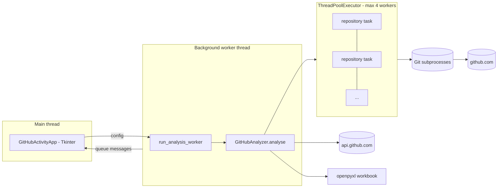
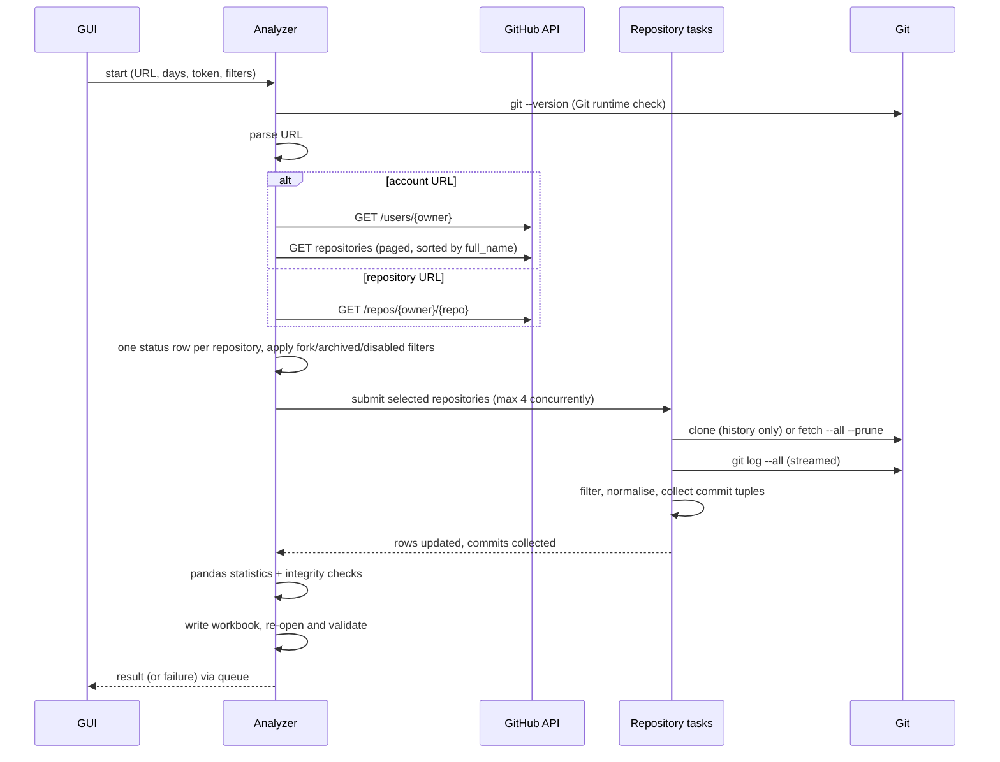

# Architecture

GitHub Developer Activity Analytics 1.0.0 is a single Python file,
`GitHub_Developer_Analytics.py`, organised in clearly separated sections. The analysis code
(`GitHubAnalyzer`) contains no GUI code, so it can be driven by the GUI, by the self-test, or by
another script.

## Overview

## Sections of the source file

| Section | Contents |
| --- | --- |
| **1. Configuration** | Constants (timeouts, retry counts, limits), application paths, status names, regular expressions, file logging. |
| **2. Security, errors, helpers** | `redact()`, `CancelledError`, `AppError`, `EmptyRepository`, robust `rmtree`, message boxes that work in windowed builds, global exception hooks. |
| **2b. Git runtime** | `resolve_git()` (bundled PortableGit first on Windows, otherwise Git on `PATH`), `git_environment()`, `kill_process_tree()`. |
| **Helpers** | `normalise_identity()`, `is_bot()`, `classify_git_error()`. |
| **3. Analyser** | `GitHubAnalyzer`: URL parsing, GitHub API access, Git operations, history extraction, per-repository processing, analytics, report generation, `analyse()`. |
| **4. Excel report** | `build_workbook()`, `build_summary()`, `write_table()`, `write_totals()`, `validate_workbook()`. |
| **5. Worker and GUI** | `run_analysis_worker()`, `format_completion_message()`, `GitHubActivityApp`. |
| **6. Self-test, build emitter, entry point** | `run_self_test()`, `emit_build_files()`, `run_gui()`, `main()`. |

## Run flow (`GitHubAnalyzer.analyse`)

1. **Git check.** `git --version` is run through the resolved runtime. With a token, Git 2.31 or
   newer is required.
2. **URL parsing.** `parse_github_url()` normalises `https://`, `github.com/…`, SSH form and
   `.git`; rejects credentials and hosts other than `github.com`.
3. **Discovery.** The account type comes from `GET /users/{owner}` (user or organisation).
   Repositories are listed from `/orgs/{login}/repos?type=all`, `/users/{login}/repos?type=owner`
   or — when a token belongs to the analysed user — `/user/repos?affiliation=owner`, in pages of
   100 sorted by `full_name` (a stable order). Each record is validated; duplicates and unreadable
   records are counted and surfaced rather than dropped silently. A shortfall against GitHub's
   public repository count produces a warning.
4. **Row bookkeeping.** Every discovered repository gets one status row with the initial status
   *Cancelled / Not Processed*; filters set it to *Excluded*. The final report reconciles these
   rows.
5. **Per-repository tasks** run in a `ThreadPoolExecutor` (at most 4 workers,
   `MAX_PARALLEL_REPOS`). Each task: skips empty or inactive repositories, clones or updates the
   local copy, extracts commits, fills its status row, and records non-fatal data notes.
6. **Analytics and report** run in the worker thread after all tasks finish (or are cancelled).

## Git integration

* Git is started with `subprocess.Popen` using an argument list (no shell), `stdin` closed,
  `CREATE_NO_WINDOW` on Windows, and a controlled environment: prompts disabled, stray `GIT_*`
  variables removed, `GIT_CEILING_DIRECTORIES` set for clone folders. `gc.auto` and maintenance are
  disabled, signature display is off, and network operations abort a fully stalled transfer
  (`http.lowSpeedLimit=1` for 180 s).
* **Clone:** `git clone --quiet --no-checkout` into `<folder>.cloning`, trying
  `--filter=tree:0`, then `--filter=blob:none`, then a full clone; the folder is renamed into
  place only on success (`move_into_place()` retries while antivirus or indexers hold files).
* **Update:** an existing copy is verified (`rev-parse --git-dir`) and updated with
  `git fetch --all --prune --quiet`. A damaged copy is re-cloned; the old copy is restored if the
  re-clone fails.
* **Read history:** `git for-each-ref --count=1` detects empty repositories; then
  `git log --all --format=…` is **streamed** in chunks of 262,144 characters by a reader thread, while a second
  thread drains `stderr`. Memory use stays bounded and cancellation and the time-out are checked
  every 0.5 s.
* **Authentication:** with a token, Git receives an `Authorization` header for
  `https://github.com/` through `GIT_CONFIG_COUNT/KEY/VALUE` environment variables.
* **Errors:** `classify_git_error()` maps Git's `stderr` to a category, a hint and a
  *transient* flag. Only transient errors are retried (`MAX_GIT_RETRIES` = 2, delays 2 s and 4 s).

## Commit extraction and filtering

Each `git log` record carries hash, author name/e-mail/epoch time, committer name/e-mail/epoch
time, parents and subject. For each record, in this order:

1. malformed record or non-numeric timestamp → *invalid*;
2. date used outside `[start, end]` (integer comparison of epoch seconds) → *outside period*;
3. hash already seen among in-window commits → *duplicate*;
4. bot filter (if enabled), merge filter (if enabled);
5. conversion to UTC datetimes (failure → *invalid*), identity normalisation, record kept.

Author and committer clean-up (illegal Excel characters, trimming) and identity/bot lookups are
cached per distinct name/e-mail pair. Every record lands in exactly one bucket, which is what
makes the *Commits Read = Found + Excluded* ledger hold.

**Time window.** `end = analysis start (UTC, whole seconds)`, `start = end − N days`; both ends
are inclusive. The same instant is used for every repository of the run.

## Identity normalisation

`normalise_identity(name, email, aliases)` returns `(key, method)` using the order *noreply
login → e-mail → name → unknown*; if `key` is a key of the alias map it is replaced and the
method becomes *Alias mapping*. The aliases come from `identity_aliases.json` (or are passed in
programmatically).

## Analytics (pandas)

`generate_report()` builds one DataFrame from the commit tuples and derives:

* `developer_frame()` — grouped by normalised identity: counts, share, repositories, first/latest
  date, inclusive span, active days (distinct normalised dates), average per active day, name and
  e-mail variants ranked by frequency;
* `repository_frame()` — the same per analysed repository;
* `counts()`, `metrics()` — repository reconciliation and run-wide figures (span and active days
  are computed over all commits together);
* `integrity_checks()` — the PASS/WARN/FAIL list; `outcome()` — the run outcome label.

## Excel report generation

`build_workbook()` creates the eight sheets with openpyxl. `write_table()` builds each cell style
once per (column, value type) and copies it onto the cells, which keeps large reports fast.
Strings are cleaned of characters Excel rejects, and text starting with `=` is forced to a string.
The workbook is written to `<name>.xlsx.tmp` and renamed, so a failed write never leaves a
half-written report; an existing report is never overwritten. After saving,
`validate_workbook()` re-opens the file (read-only) and checks sheet names, headers and
cross-sheet totals; problems are reported to the user.

## Concurrency model

| Thread | Responsibility |
| --- | --- |
| Main (Tk) | All widgets. Polls a `queue.Queue` every 50 ms (at most 400 messages per poll) for `log`, `progress`, `done` and `failure` messages. |
| Worker | `run_analysis_worker()` → `analyse()`: discovery, scheduling, analytics, report. Never touches Tk. |
| Pool workers (≤ 4) | One repository each: Git clone/fetch and history extraction. Log lines are prefixed with the repository name when more than one worker is used. |
| Git reader threads | Per streamed `git log`: one thread reads `stdout`, one drains `stderr`. |

Cancellation is a shared `threading.Event`. Sleeps, API loops, Git polling loops and the stream
reader all check it; running Git process trees are killed (`taskkill /T` on Windows, process-group
kill elsewhere). Unstarted tasks return immediately.

## Error handling model

* `AppError` carries a *category*, a *hint*, a *transient* flag, the retry count and the stage.
* API errors (`_http_error()`) distinguish authentication, permission, SAML SSO, primary and
  secondary rate limits, not found, legal block (451), request errors and server errors.
  Transient errors are retried up to 4 times with back-off (2, 4, 8, 16 s); a rate-limit wait is
  honoured up to 120 s.
* A failure inside one repository marks only that repository *Failed*; the run continues.
* A failure after the first page of the repository list keeps the pages already retrieved and
  marks discovery as incomplete.
* Uncaught exceptions are logged (redacted) and shown in a message box (this also works
  without a console window).

## Git runtime resolution and optional helpers

`resolve_git()` looks for a PortableGit folder (`PortableGit` beside the script, or the
equivalent folder in a frozen build) on Windows and validates it (`git.exe`,
`git-remote-https.exe`); otherwise it falls back to `git` on `PATH`. For a bundled Git, `PATH`
and `GIT_EXEC_PATH` point into that folder so that no Git installed on the host is used.
`run_self_test()` (`--self-test`) verifies imports, writable folders, certificates, Tk, Excel
writing, Git and optionally HTTPS access. `emit_build_files()` (`--emit-build-files`) is an
optional developer helper that writes a PyInstaller `.spec` and version resource; this
repository neither documents a build procedure nor distributes an executable.

## Key constants

| Constant | Value | Purpose |
| --- | --- | --- |
| `DEFAULT_DAYS` / `MAX_DAYS` | 90 / 3650 | Reporting period |
| `REQUEST_TIMEOUT` | (10 s, 30 s) | API connect / read timeouts |
| `PER_PAGE` / `MAX_PAGES` | 100 / 500 | API paging and safety limit |
| `MAX_API_RETRIES` / `MAX_GIT_RETRIES` | 4 / 2 | Retries for transient failures |
| `MAX_RATE_LIMIT_WAIT` | 120 s | Longest automatic rate-limit wait |
| `MAX_PARALLEL_REPOS` | 4 | Concurrent repositories |
| `INACTIVE_MARGIN_DAYS` | 2 | Safety margin for *skip inactive* |
| `MIN_FREE_BYTES` | 300 MB | Minimum free disk space before a clone |
| `MAX_EXCEL_DATA_ROWS` | 1,000,000 | Rows per *Commit Details* sheet |
